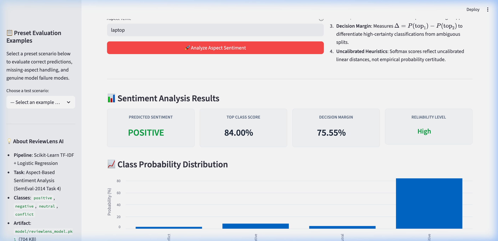
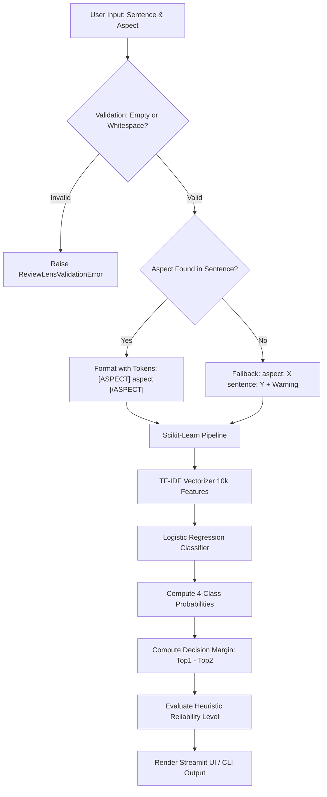

# ReviewLens AI — Aspect-Based Sentiment Analysis

[](https://www.python.org/)
[](https://streamlit.io/)
[](https://scikit-learn.org/)
[](LICENSE)
[](tests/)

> **SWYNEX Technologies Internship — Task 4: Final AI Application**  
> **Final Repository**: [https://github.com/Jyo-08/SWYNEX-AI-APPLICATION](https://github.com/Jyo-08/SWYNEX-AI-APPLICATION)<br>
> **Live demo Link** : https://swynexaiapp.streamlit.app/

---

## Table of Contents

- [A. Project Overview](#a-project-overview)
- [B. Problem Statement](#b-problem-statement)
- [C. Proposed Solution](#c-proposed-solution)
- [D. Machine Learning Methodology](#d-machine-learning-methodology)
- [E. Technology Stack](#e-technology-stack)
- [F. Architecture & Project Structure](#f-architecture--project-structure)
- [G. Prerequisites & Installation](#g-prerequisites--installation)
- [H. Running the Application](#h-running-the-application)
- [I. Verified Examples & Demo](#i-verified-examples--demo)
- [J. Evaluation & Testing](#j-evaluation--testing)
- [K. Limitations & Failure Modes](#k-limitations--failure-modes)
- [L. Ethics & Responsible Use](#l-ethics--responsible-use)
- [M. Dataset Provenance & Licensing](#m-dataset-provenance--licensing)
- [N. Troubleshooting](#n-troubleshooting)
- [O. Future Improvements](#o-future-improvements)
- [P. Final Submission Details](#p-final-submission-details)

---

## A. Project Overview

**ReviewLens AI** is an intelligent, beginner-friendly Aspect-Based Sentiment Analysis (ABSA) application built with Python, scikit-learn, and Streamlit.

Unlike conventional sentiment analysis tools that classify an entire customer review as simply "positive" or "negative", ReviewLens AI evaluates consumer sentiment toward a **specific component, feature, or attribute** (such as a laptop's *keyboard*, *battery life*, *display*, or *build quality*).

Designed as the capstone implementation for **SWYNEX Internship Task 4**, ReviewLens AI combines a trained linear machine learning pipeline with practical safeguards: input validation, missing-aspect detection, decision-margin calculation, heuristic reliability guidance, and an interactive Streamlit user interface.



---

## B. Problem Statement

Consumer product reviews are inherently multi-faceted:
> *"The display is crystal clear and vivid, but the battery runs out within three hours."*

When a standard sentiment analysis tool evaluates this sentence, it collapses opposing opinions into an arbitrary single label (often neutral or positive). This hides critical business intelligence:
1. **Feature Masking**: Product managers cannot isolate why users are dissatisfied when negative remarks about specific parts are masked by high general praise.
2. **Ambiguity in Mixed Sentiment**: When reviews contain contrastive statements (*"loved X, hated Y"*), traditional bag-of-words document classifiers produce unstable predictions.
3. **Overconfidence in Ambiguous Cases**: Many classifiers output softmax probabilities that look authoritative (e.g., 51% vs. 49%), leading users to trust predictions that are essentially statistical coin flips.

**Aspect-Based Sentiment Analysis (ABSA)** resolves this by conditioning the sentiment prediction directly on the chosen target aspect within the sentence context.

---

## C. Proposed Solution

ReviewLens AI delivers an end-to-end, transparent AI workflow:

```
[ Customer Review Text ] + [ Target Aspect ]
                    │
                    ▼
       Input Validation & Sanitization
                    │
                    ▼
   Aspect Presence Check & Position Tagging
     ├── If Found: "The [ASPECT] battery [/ASPECT] is great"
     └── If Missing: "aspect: battery sentence: Great design" (Warning Alert)
                    │
                    ▼
     TF-IDF Vectorization (10,000 N-Gram Features)
                    │
                    ▼
  Balanced Logistic Regression Inference (4 Polarities)
                    │
                    ▼
   Decision Margin & Reliability Heuristic Assessment
                    │
                    ▼
  Streamlit Interactive Web UI / Command-Line Interface
```

### Key Features
- **Aspect-Aware Positioning**: Inserts boundary markers `[ASPECT] ... [/ASPECT]` around the target entity so the classifier learns contextual weights in proximity to the aspect.
- **Missing-Aspect Safeguard**: Verifies whether the aspect actually appears in the text. If absent, fallback prefix representation is used, an alert is displayed, and the reliability rating is automatically downgraded.
- **Decision Margin Calculation**: Computes the gap between the primary and secondary class probabilities:
  $$\Delta = P(\text{top}_1) - P(\text{top}_2)$$
- **Heuristic Reliability Guidance**: Explicitly flags predictions as **High**, **Moderate**, or **Low / Ambiguous** based on class separation and aspect presence.
- **Calibration Transparency**: Clearly distinguishes uncalibrated softmax estimates from true statistical likelihoods.
- **Interactive Preset Scenarios**: Preloaded evaluation cases illustrating authentic successes, neutral statements, missing aspects, and documented model failure modes.

---

## D. Machine Learning Methodology

### 1. Text Preprocessing & Aspect-Aware Input Preparation
To help a bag-of-words model identify which words relate to which feature, ReviewLens AI dynamically injects position tokens:
```python
# When aspect is present in sentence:
sentence[:start] + "[ASPECT] " + aspect + " [/ASPECT]" + sentence[end:]
# Example: "The [ASPECT] keyboard [/ASPECT] feels cheap."

# Fallback when aspect is not found in text:
f"aspect: {aspect} sentence: {sentence}"
```

### 2. TF-IDF Feature Extraction
- **N-Gram Range**: Unigrams and bigrams (`ngram_range=(1, 2)`), capturing two-word contextual pairs like *"very good"*, *"cheap keyboard"*, and *"battery life"*.
- **Sublinear Term Frequency**: Applies logarithmic term-frequency scaling ($1 + \log(\text{tf})$) to prevent high-frequency words from disproportionately dominating feature weights.
- **Vocabulary Limit**: Capped at 10,000 most informative features to maintain a lightweight (~704 KB) deployable artifact.

### 3. Logistic Regression Classification
- **Multi-Class Strategy**: Multinomial logistic regression estimating probabilities across 4 target classes: `positive`, `negative`, `neutral`, and `conflict`.
- **Balanced Class Weights**: Automatically adjusts weights inversely proportional to class frequencies (`class_weight="balanced"`), countering the severe underrepresentation of classes like `conflict`.
- **Convergence Optimization**: Configured with `max_iter=2000` using the L-BFGS numerical solver.

### 4. Decision Margin & Heuristic Reliability Guidance
Softmax probability outputs from a linear model reflect Euclidean distances from the hyperplanes rather than true Bayesian posterior probabilities. ReviewLens AI introduces an empirical safety layer:
- **Decision Margin ($\Delta$)**: The mathematical difference between the top class probability and the second-place class probability:
  $$\Delta = P(\text{class}_1) - P(\text{class}_2)$$
- **Reliability Tiers**:
  - **High**: $P(\text{top}) \ge 65\%$, $\Delta \ge 25\%$, and aspect is present in the review.
  - **Moderate**: $P(\text{top}) \ge 45\%$, $\Delta \ge 12\%$, and aspect is present in the review.
  - **Low / Ambiguous**: $\Delta < 12\%$, $P(\text{top}) < 45\%$, or the aspect was missing from the text.

---

## E. Technology Stack

| Technology | Version / Role | Purpose in ReviewLens AI |
|---|---|---|
| **Python** | `3.9+` (verified `3.9.6`) | Core programming language |
| **scikit-learn** | `1.6.1` | TF-IDF feature extraction and Logistic Regression pipeline |
| **pandas** | `2.3.3` | Tabular data manipulation and display formatting |
| **joblib** | `1.5.3` | Model serialization and rapid artifact loading |
| **Streamlit** | `1.30.0+` (verified `1.50.0`) | Interactive web interface and data visualization |
| **unittest** | Standard Library | Automated unit and integration testing (23 tests) |

---

## F. Architecture & Project Structure

### Pipeline Flowchart



### Directory Tree

```
SWYNEX-AI-APPLICATION/
├── .gitignore               # Excludes .venv, caches, *.mov/mp4, and data/*.csv
├── DEMO_CHECKLIST.md        # Walkthrough sequence, video guide, and presentation script
├── README.md                # Comprehensive documentation, setup, and evaluation
├── app.py                   # Streamlit web application with preset evaluation scenarios
├── assets/
│   └── reviewlens_ui.png    # Authentic screenshot of the running Streamlit web app
├── data/
│   └── .gitkeep             # Local data directory placeholder (raw dataset CSV excluded)
├── examples/
│   └── predictions.md       # Documented empirical evaluation and root-cause failure cases
├── model/
│   └── reviewlens_model.pkl # Pre-trained serialized model artifact (704 KB)
├── predict.py               # Core inference engine with validation and reliability guidance
├── requirements.txt         # Pinned application dependencies
├── tests/
│   └── test_reviewlens.py   # 23 automated unit and integration tests
└── train.py                 # Reproducible training pipeline script (manual execution)
```

---

## G. Prerequisites & Installation

### Prerequisites
- **Python**: Version `3.9` or higher (verified on Python 3.9.6).
- **Git**: For cloning the repository.
- **Operating System**: macOS, Linux, or Windows.

### Copy-Paste Installation Steps

#### 1. Clone the Task 4 Repository
```bash
git clone https://github.com/Jyo-08/SWYNEX-AI-APPLICATION.git
cd SWYNEX-AI-APPLICATION
```

#### 2. Create and Activate Virtual Environment

- **macOS / Linux**:
  ```bash
  python3 -m venv .venv
  source .venv/bin/activate
  ```

- **Windows (Command Prompt / PowerShell)**:
  ```cmd
  python -m venv .venv
  .venv\Scripts\activate
  ```

#### 3. Install Dependencies
```bash
pip install --upgrade pip
pip install -r requirements.txt
```

---

## H. Running the Application

### Option 1: Interactive Streamlit Web Interface (Recommended)

Start the local web application:
```bash
streamlit run app.py
```

1. Open your browser at `http://localhost:8501`.
2. Use the **Preset Evaluation Examples** dropdown in the sidebar to load test cases, or enter custom review text and an aspect term in the main panel.
3. Click **🚀 Analyze Aspect Sentiment**.
4. Review the predicted sentiment badge, top score, decision margin, reliability tier, and the complete probability distribution chart.

### Option 2: Command-Line Interface (CLI)

Run interactive terminal-based inference:
```bash
python predict.py
```

Example interactive session:
```text
============================================================
           ReviewLens AI — Final Application (Task 4)
   Intelligent Aspect-Based Sentiment Analysis & Guidance
============================================================

Enter review sentence: the laptop is very good
Enter aspect term: laptop

===== Prediction & Reliability =====
Sentence          : the laptop is very good
Aspect            : laptop
Aspect In Text    : Yes
Sentiment         : POSITIVE
Confidence (Top)  : 84.00%
Decision Margin   : 75.55% (over negative)
Reliability Level : High
Guidance          : Prediction has high class separation and dominant probability.

===== Class Probabilities =====
Positive  : 84.00%
Negative  : 8.46%
Neutral   : 4.45%
Conflict  : 3.09%

Notice: Model scores are uncalibrated softmax estimates from a linear TF-IDF classifier. Heuristic reliability levels are rule-based guidelines, not statistically calibrated probabilities.
============================================================
```

---

## I. Verified Examples & Demo

All outputs below are authentic, reproducible results obtained from `model/reviewlens_model.pkl`:

### 1. Positive Scenario
- **Sentence**: `the laptop is very good`
- **Aspect**: `laptop`
- **Predicted Polarity**: **POSITIVE**
- **Top Score**: `84.00%` | **Decision Margin**: `75.55%` (over Negative `8.46%`)
- **Reliability**: **High**
- **Status**: Successful prediction with high class separation.

### 2. Documented Model Failure Case 1 (Keyboard)
- **Sentence**: `The keyboard feels cheap and uncomfortable.`
- **Aspect**: `keyboard`
- **Predicted Polarity**: **POSITIVE** *(Incorrect — True human sentiment: Negative)*
- **Top Score**: `42.33%` | **Decision Margin**: `9.70%` (over Negative `32.63%`)
- **Reliability**: **Low / Ambiguous**
- **Root Cause**: The linear TF-IDF model lacks syntactic clause parsing, but the **decision margin safeguard** successfully detects the narrow gap (`< 12%`) and warns the user.

### 3. Documented Model Failure Case 2 (Battery Life)
- **Sentence**: `The battery life is terrible and disappointing.`
- **Aspect**: `battery life`
- **Predicted Polarity**: **POSITIVE** *(Incorrect — True human sentiment: Negative)*
- **Top Score**: `50.89%` | **Decision Margin**: `21.71%` (over Negative `29.18%`)
- **Reliability**: **Moderate**
- **Root Cause**: High prevalence of positive vocabulary in the training corpus and sparse bigram interactions cause positive class bias. Demonstrates why softmax probabilities cannot be treated as calibrated truth.

### 4. Neutral Scenario
- **Sentence**: `The laptop came preloaded with Windows 7.`
- **Aspect**: `Windows 7`
- **Predicted Polarity**: **NEUTRAL**
- **Top Score**: `33.91%` | **Decision Margin**: `0.61%` (over Negative `33.30%`)
- **Reliability**: **Low / Ambiguous**
- **Observation**: Correctly identifies the factual statement, but flags low separation.

### 5. Missing-Aspect Safeguard Scenario
- **Sentence**: `Great lightweight design and very durable.`
- **Aspect**: `battery`
- **Aspect Located in Text**: **No** (`aspect_found=False`)
- **Warning**: `Aspect 'battery' was not located in the sentence text. Model evaluated using fallback prefix formatting.`
- **Reliability**: **Low / Ambiguous** *(Automatic safeguard downgrade)*

### Demonstration Video & Checklist
A local demonstration recording (`23.5s`, `2816x1762`, `11.4 MB`) was verified on the local development workstation.
- Full presentation script and instructions for uploading to Google Drive/YouTube: see [`DEMO_CHECKLIST.md`](DEMO_CHECKLIST.md).
- To link your hosted recording: replace the placeholder below with your public video URL:
  - **Demo Video URL**: *[Hosted Video Link — Follow instructions in DEMO_CHECKLIST.md]*

---

## J. Evaluation & Testing

### 1. Automated Test Suite (Unit & Integration Tests)
ReviewLens AI includes 23 automated tests in `tests/test_reviewlens.py` using Python's standard `unittest` framework:

```bash
python -m unittest -v tests/test_reviewlens.py
```

**Actual Execution Results**:
```text
test_aspect_absent (tests.test_reviewlens.TestAspectDetectionAndPreprocessing) ... ok
test_aspect_present_case_insensitive (tests.test_reviewlens.TestAspectDetectionAndPreprocessing) ... ok
test_mark_aspect_when_absent (tests.test_reviewlens.TestAspectDetectionAndPreprocessing) ... ok
test_mark_aspect_when_present (tests.test_reviewlens.TestAspectDetectionAndPreprocessing) ... ok
test_actual_model_prediction_structure (tests.test_reviewlens.TestInferenceAndPredictionStructure) ... ok
test_backward_compatibility_predict_sentiment (tests.test_reviewlens.TestInferenceAndPredictionStructure) ... ok
test_missing_aspect_warning_and_fallback (tests.test_reviewlens.TestInferenceAndPredictionStructure) ... ok
test_probabilities_sum_to_one (tests.test_reviewlens.TestInferenceAndPredictionStructure) ... ok
test_broken_estimator_raises_inference_error (tests.test_reviewlens.TestInferenceFailureHandling) ... ok
test_empty_aspect_raises_error (tests.test_reviewlens.TestInputValidation) ... ok
test_empty_sentence_raises_error (tests.test_reviewlens.TestInputValidation) ... ok
test_non_string_aspect_raises_error (tests.test_reviewlens.TestInputValidation) ... ok
test_non_string_sentence_raises_error (tests.test_reviewlens.TestInputValidation) ... ok
test_valid_input_strips_whitespace (tests.test_reviewlens.TestInputValidation) ... ok
test_whitespace_aspect_raises_error (tests.test_reviewlens.TestInputValidation) ... ok
test_whitespace_sentence_raises_error (tests.test_reviewlens.TestInputValidation) ... ok
test_corrupted_model_file_raises_model_error (tests.test_reviewlens.TestModelLoadingAndErrorHandling) ... ok
test_invalid_estimator_object_raises_model_error (tests.test_reviewlens.TestModelLoadingAndErrorHandling) ... ok
test_missing_model_file_raises_model_error (tests.test_reviewlens.TestModelLoadingAndErrorHandling) ... ok
test_high_reliability_criteria (tests.test_reviewlens.TestReliabilityAndGuidanceHeuristics) ... ok
test_low_reliability_due_to_narrow_margin (tests.test_reviewlens.TestReliabilityAndGuidanceHeuristics) ... ok
test_low_reliability_when_aspect_missing (tests.test_reviewlens.TestReliabilityAndGuidanceHeuristics) ... ok
test_moderate_reliability_criteria (tests.test_reviewlens.TestReliabilityAndGuidanceHeuristics) ... ok

----------------------------------------------------------------------
Ran 23 tests in 0.008s

OK
```

### 2. Model Performance Evaluation (Held-Out Test Set)
> [!IMPORTANT]
> The automated unit tests verify software correctness and safety safeguards. Model accuracy evaluation is a distinct statistical assessment conducted on a stratified 20% held-out test split of 472 SemEval-2014 Task 4 laptop samples:

| Metric | Result |
|---|---:|
| **Test Set Size** | 472 samples |
| **Overall Accuracy** | **71.82%** |
| **Macro F1-Score** | **55.87%** |

#### Class Support Breakdown in Test Split
- **Positive**: 198 samples (dominant class)
- **Negative**: 173 samples
- **Neutral**: 92 samples
- **Conflict**: 9 samples (severely underrepresented)

---

## K. Limitations & Failure Modes

1. **Uncalibrated Probabilities**: Softmax values are not calibrated probabilities. A 51% probability does not mean the model has 51% statistical confidence.
2. **Class Imbalance**: The training dataset contains far more positive examples than neutral or conflict examples. Even with `class_weight="balanced"`, the model exhibits positive polarity bias on ambiguous inputs.
3. **Bag-of-Words & Syntactic Blind Spots**: TF-IDF n-grams cannot perform dependency parsing. In contrastive sentences (*"Great screen, but awful battery"*), strong positive adjectives often overwhelm nearby negative modifiers.
4. **Negation Scope & Sarcasm**: Sarcastic remarks (*"Oh fantastic, another crash"*) and distant negations are frequently misclassified.
5. **Domain Specificity**: The model vocabulary was trained exclusively on laptop reviews and will not generalize reliably to restaurants, movies, or financial text.

---

## L. Ethics & Responsible Use

- **Data Privacy**: ReviewLens AI runs 100% locally and offline. No review text, aspect inputs, or prediction logs are transmitted to external servers or third-party APIs.
- **Human-in-the-Loop Requirement**: Because linear models exhibit documented blind spots, ReviewLens AI is intended as a decision-support aid, not an autonomous arbiter. Critical decisions (e.g., supplier penalties or product recalls) should never be made based solely on automated predictions.
- **Fairness & Bias**: Product sentiment classifiers can reflect geographic, linguistic, or cultural phrasing biases present in customer review corpora.

---

## M. Dataset Provenance & Licensing

- **Dataset**: SemEval-2014 Task 4 (Aspect-Based Sentiment Analysis — Laptop Domain).
- **Redistribution Policy**: The raw training CSV is excluded from version control via `.gitignore` to comply with standard academic data sharing guidelines.
- **Reproduction**: Users wishing to retrain the model can obtain the official benchmark dataset from the [SemEval-2014 Task 4 repository](https://alt.qcri.org/semeval2014/task4/) and place it at `data/Laptop_Train_v2.csv`.
- **Pre-Trained Model Checksum**:
  - `model/reviewlens_model.pkl` SHA-256:
    `f91afc5c9dfbefaf2d049c151a8cec6d44629b62e5966c0380f375714aa3cfdb`

---

## N. Troubleshooting

### 1. `ReviewLensModelError: Model artifact not found`
- **Cause**: `model/reviewlens_model.pkl` is missing or the working directory is incorrect.
- **Fix**: Run commands from the repository root: `python -m unittest discover tests` or `streamlit run app.py`.

### 2. `ReviewLensValidationError: Review sentence cannot be empty`
- **Cause**: Provided empty text or only whitespace characters.
- **Fix**: Enter a valid non-empty review and aspect term.

### 3. Port 8501 Already in Use
- **Cause**: Another Streamlit instance is currently running.
- **Fix**: Run Streamlit on a different port:
  ```bash
  streamlit run app.py --server.port 8502
  ```

### 4. Dependency Conflicts
- **Fix**: Ensure your virtual environment is active and reinstall pinned dependencies:
  ```bash
  pip install -r requirements.txt --force-reinstall
  ```

---

## O. Future Improvements

1. **Probability Calibration**: Implement Platt Scaling or Isotonic Regression on held-out validation data to convert softmax scores into statistically calibrated confidence intervals.
2. **Contextual Transformer Embeddings**: Migrate from linear TF-IDF to transformer-based architectures (e.g., DeBERTa-v3 or RoBERTa) with cross-attention between review tokens and aspect tokens.
3. **Multi-Aspect Extraction**: Add automated aspect-term extraction (BIO tagging) to discover aspects automatically rather than requiring manual user specification.
4. **Interactive Explanation**: Incorporate SHAP or LIME text explainers to highlight the exact n-grams driving each polarity decision.

---

## P. Final Submission Details

- **Internship**: SWYNEX Technologies Internship Program
- **Task**: Task 4 — Final AI Application
- **Author**: Jyo-08
- **Final Repository**: [https://github.com/Jyo-08/SWYNEX-AI-APPLICATION](https://github.com/Jyo-08/SWYNEX-AI-APPLICATION)
- **Model Checksum (SHA-256)**: `f91afc5c9dfbefaf2d049c151a8cec6d44629b62e5966c0380f375714aa3cfdb`
- **Automated Test Results**: 23/23 tests passed (`0.008s`)
